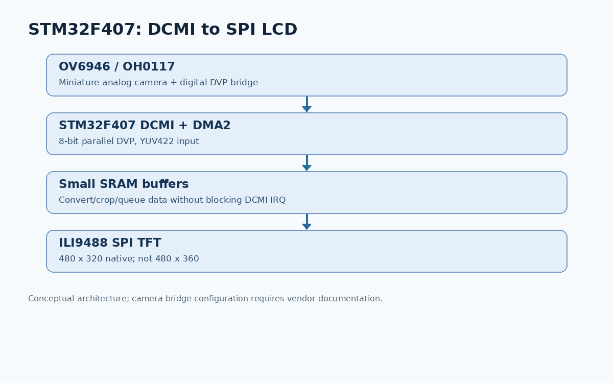
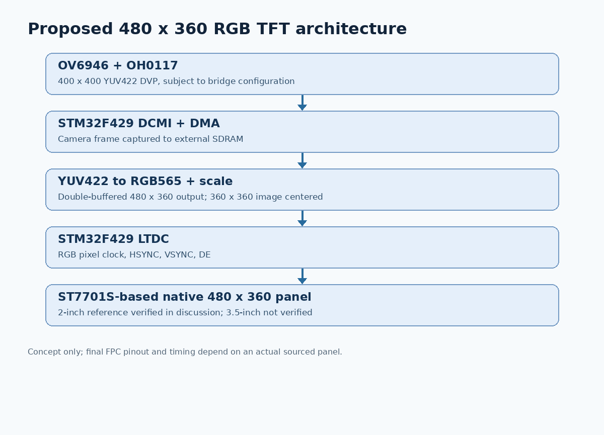
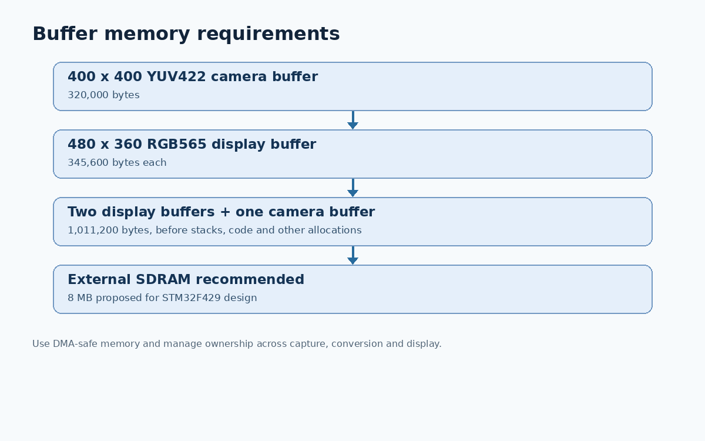

# Miniature Camera to STM32 TFT — Conversation Archive

**Archive date:** 2026-10-29  
**Topic:** Sub-4-mm miniature camera → STM32 DCMI → 3.5-inch TFT LCD, culminating in a native 480×360 display request.  
**Scope:** Chronological reconstruction of all technical discussions in this channel, including specifications, code excerpts, product references, architecture changes, and outstanding engineering work. The archive summarizes conversational answers rather than claiming a verbatim export of every rendered product image or interactive control. Links and advertised prices are historical statements from the conversation, not independently reverified in this export.

## Contents

1. Initial requirements and camera selection
2. Product pricing, datasheets, and images
3. STM32F407 DCMI → TFT implementation
4. STM32CubeIDE firmware package
5. GitHub DCMI source references
6. Full-device architecture for 3.5-inch TFT
7. Native 480×360 panel decision and STM32F429 design
8. Current status, risks, and next steps
9. Original code excerpts and download references

---

## 1. Initial requirements and camera selection

### User request

> We are looking for a tiny camera of which the diameter is smaller than 4mm. We are going to display the camera frame in STM32 series ARM chip such as STM32F407 or similar. The camera should have DCMI interface rather than USB. Give me the list of camera products.

### Requirements discussed

| Property | Target |
|---|---|
| Camera head | Strictly less than 4 mm diameter |
| Camera data | 8-bit parallel DVP compatible with STM32 DCMI |
| Host MCU | STM32F407 or similar |
| Display | 3.5-inch TFT |
| Video format | RGB565 or YUV422 preferred |
| USB | Not used |
| Camera configuration | SCCB/I²C or manufacturer SDK |

**Terminology:** DCMI is an STM32 peripheral. Sensors usually advertise a *DVP parallel interface* with D0–D7, PCLK, HSYNC/HREF, VSYNC. Analog, USB, and MIPI CSI-2 outputs are not directly compatible.

### Camera candidates discussed

| Product | Dimensions / resolution discussed | Output | Direct DCMI? | Notes |
|---|---|---|---|---|
| OMNIVISION OVM6948 | 0.65×0.65×1.158 mm; 200×200 | Analog | No | Tiny complete camera module |
| OMNIVISION OV6948 | 0.575×0.575 mm; 200×200 | Analog | No | Bare sensor, needs optics |
| OMNIVISION OV6946 | About 0.95×0.94 mm; 400×400 | Analog AntLinx | No | Tiny sensor for endoscope designs |
| OV7675 DVP module | VGA 640×480; complete head diameter not verified | Parallel DVP | Yes | Development candidate only |
| OV2640 DVP module | Up to 1600×1200; complete head diameter not verified | Parallel DVP | Yes | Development candidate only |
| OV5640 DVP module | Up to 2592×1944; complete head diameter not verified | Parallel DVP | Yes | Development candidate only |

**Conclusion:** No off-the-shelf camera was verified to satisfy both a *complete head under 4 mm* and *native parallel DVP output*. The proposed solution placed an analog-to-DVP bridge outside the camera head.

### Bridge processors

- **OV426:** OMNIVISION video processor; analog camera input, parallel DVP output. Manufacturer: https://www.ovt.com/products/ov426/
- **OH0117:** OMNIVISION processor board for miniature cameras with DVP YUV422 output. Manufacturer: https://www.ovt.com/products/oh0117/

Suggested architecture: **OV6946 → OH0117 or OV426 → STM32 DCMI → DMA → LCD**.



---

## 2. Prices, datasheets, and product pictures

### User request

> Give me price for each product and datasheet and picture in png format.

### Prices reported in the discussion

These prices were presented during the earlier conversation. **They are not verified current quotations.**

| Product | Previously reported price | Purchase / documentation |
|---|---:|---|
| OVM6948 | $63.25 each | https://www.ichome.com/product-detail/omnivision-technologies/ovm6948-rala |
| OV6948 | Request quote | https://www.ovt.com/products/ov6948/ |
| OV6946 | Request quote | https://www.ovt.com/products/ov6946/ |
| Camemake CM_ENDO_001 endoscope assembly | $143.43 each, MOQ 10 | https://www.camemake.eu/shop/endoscope-17/cm-endo-001-ultra-compact-endoscope-module-with-omnivision-ov6946-sensor-957 |
| OV426 processor | Request quote | https://www.ovt.com/products/ov426/ |
| OH0117 processor | Request quote | https://www.ovt.com/products/oh0117/ |
| OV7675 module | $5.25–$5.99 | Depends on seller |
| OV2640 module | $6.99–$9.99 | Depends on seller |
| OV5640 module | $14.95–$25.64 | Depends on seller |

**Caution:** The Camemake listing was described as inconsistent about the sensor model; verify with the seller. The complete camera housing diameter, output interface, and actual inventory require confirmation.

### Public product briefs and datasheets cited

- OVM6948: https://www.ovt.com/wp-content/uploads/2023/03/OVM6948-PB-v1.5-WEB.pdf
- OV6948: https://www.ovt.com/wp-content/uploads/2023/02/OV6948-PB-v1.7-WEB.pdf
- OV6946: https://www.ovt.com/wp-content/uploads/2022/01/OV6946-PB-v1.8-WEB.pdf
- OVM6946: https://www.ovt.com/wp-content/uploads/2023/02/OVM6946-PB-v1.7-WEB.pdf
- OV426: https://www.ovt.com/wp-content/uploads/2024/07/OV426-PB-v1.2-WEB.pdf
- OH0117: https://www.ovt.com/products/oh0117/
- OV5640: https://files.waveshare.com/upload/d/da/OV5640_DataSheet.pdf
- ArduCAM camera shield reference: https://www.arducam.com/downloads/shields/ArduCAM_Camera_Shield_V2_DS.pdf

**PNG images in this package:** The three images in `images/` are newly authored *technical architecture diagrams*, not manufacturer product photographs. Original product photographs shown by search in the chat were not available as reusable image files for this export. Do not interpret the diagrams as product photographs.

---

## 3. STM32F407 DCMI capture and SPI TFT firmware

### User request

> Generate code in this channel which render camera frame to TFT LCD from DCMI.

The discussion initially proposed:

- STM32F407 MCU, STM32 HAL/CubeIDE
- 8-bit DVP camera interface
- DCMI + DMA2 Stream1 Channel1
- 320×240 RGB565 input
- 3.5-inch ILI9488 SPI TFT, **480×320** native orientation
- Small camera buffers, no full-frame RGB565 buffer

### Dataflow

```text
Camera DVP D0–D7, PCLK, VSYNC, HREF
    → STM32F407 DCMI
    → DMA2
    → small RGB565 line buffers
    → SPI TFT pixel transfer
    → ILI9488 480×320
```

### DCMI setup discussed

| Option | Initial setting |
|---|---|
| Capture | Continuous |
| Data width | 8-bit |
| Sync | Hardware |
| PCLK polarity | Rising (must match camera timing) |
| VSYNC/HSYNC | Match camera output |
| DMA | DMA2 Stream1 Channel1 |
| DMA direction | Peripheral to memory |
| DMA mode | Circular |
| DMA alignment | Word |

### Initial example — capture callbacks (illustrative, **not production safe**)

```c
#define CAM_WIDTH 320
#define CAM_HEIGHT 240
#define LINE_WORDS (CAM_WIDTH * 2 / 4)
static uint32_t dcmi_buffer[LINE_WORDS * 2];
static volatile uint32_t camera_line = 0;

void HAL_DCMI_DMAHalfCpltCallback(DCMI_HandleTypeDef *hdcmi)
{
    Camera_DrawLine(&dcmi_buffer[0]);
}

void HAL_DCMI_DMACpltCallback(DCMI_HandleTypeDef *hdcmi)
{
    Camera_DrawLine(&dcmi_buffer[LINE_WORDS]);
}

void Camera_Start(void)
{
    camera_line = 0;
    HAL_DCMI_Start_DMA(&hdcmi, DCMI_MODE_CONTINUOUS,
                       (uint32_t)dcmi_buffer, LINE_WORDS * 2);
}
```

**Critical correction from the discussion:** `Camera_DrawLine()` must not perform blocking SPI transfers inside the DCMI DMA interrupt callbacks. That can stall DMA handling, overwrite line buffers, and lose frame synchronization. The example was an instructional skeleton only. A robust solution must queue completed buffers, process them outside the interrupt, detect overruns, and handle frame boundaries deterministically.

### Initial ILI9488 SPI primitives

```c
void LCD_SetWindow(uint16_t x1, uint16_t y1,
                   uint16_t x2, uint16_t y2)
{
    uint8_t data[4];
    LCD_Command(0x2A); // column address
    data[0] = x1 >> 8; data[1] = x1;
    data[2] = x2 >> 8; data[3] = x2;
    LCD_Data(data, 4);

    LCD_Command(0x2B); // row address
    data[0] = y1 >> 8; data[1] = y1;
    data[2] = y2 >> 8; data[3] = y2;
    LCD_Data(data, 4);
    LCD_Command(0x2C); // memory write
}
```

ILI9488 SPI panels often require 18-bit/RGB666 pixel writes. A 16-bit RGB565 SPI transmit path is **not universally valid**. The exact LCD module datasheet and pixel format must govern the driver.

### Throughput estimates discussed

For a 320×240 RGB565 frame (153,600 bytes), theoretical SPI payload times:

| SPI | Payload transfer time | Theoretical fps |
|---|---:|---:|
| 10 MHz | 123 ms | 8.1 |
| 20 MHz | 61 ms | 16.3 |
| 40 MHz | 31 ms | 32.6 |

At 40 MHz, RGB666 320×240 needs ~46 ms of payload time. Actual frame rate is lower due to commands, software overhead, conversion and contention.

---

## 4. Requested complete STM32CubeIDE project

### User request

> Generate a complete STM32CubeIDE firmware project for camera OV6946 + OH0117, LCD ILI9488 SPI 480x320, MCU STM32F407. Include correct pin assignments, DCMI DMA buffering, LCD driver, sensor initialization where documented, and build instructions.

A source-level HAL integration ZIP was produced in the conversation. **It was explicitly not a compiled or hardware-tested turnkey CubeIDE project.** It lacks a generated `.ioc` file and the proprietary OH0117 initialization sequence.

### Previously proposed STM32-side pins

| Signal | STM32F407 pin |
|---|---|
| DCMI D0–D3 | PC6–PC9 |
| DCMI D4 | PC11 |
| DCMI D5 | PB6 |
| DCMI D6–D7 | PE5–PE6 |
| DCMI PCLK | PA6 |
| DCMI HSYNC | PA4 |
| DCMI VSYNC | PB7 |
| SPI1 SCK | PA5 |
| SPI1 MOSI | PA7 |
| LCD CS / DC / RESET | PD0 / PD1 / PD2 |

**Important:** These were proposed MCU pin assignments, not a verified OH0117 connector wiring diagram. Check alternate functions, package pin availability, board-level conflicts, and the actual camera bridge pinout before PCB fabrication.

### Source package contents reported

```text
Core/Inc/app_camera.h
Core/Src/app_camera.c
Core/Src/integration_snippet.c.txt
README.md
```

The original archive is included alongside this Markdown export as `stm32_ov6946_oh0117_firmware.zip`.

### Integration workflow discussed

1. Create CubeIDE project for the exact STM32F407 part.
2. Configure GPIO, DMA2, DCMI, SPI1, I²C and clocks.
3. Generate HAL startup and peripheral files.
4. Copy app camera source files into the project.
5. Connect interrupts and callbacks.
6. Configure OH0117 with manufacturer SDK and verify DVP byte order and timing.
7. Flash via ST-LINK and validate LCD independently before camera streaming.

---

## 5. GitHub code references for DCMI video

### User request

> Give me the github code urls which render camera frame from DCMI.

The following URLs were presented in the discussion. They are reference projects, **not guaranteed drop-in builds for the selected camera and LCD**.

1. STM32F407 / OV7725: https://github.com/xujunjie96/STM32F407-OV7725
2. STM32F4 / OV7670 live view: https://github.com/iwatake2222/Camera_STM32_StdLib
3. STM32F4 / OV7670 digital camera: https://github.com/iwatake2222/DigitalCamera_STM32
4. Official STM32CubeF4 DCMI capture example: https://github.com/STMicroelectronics/STM32CubeF4/tree/master/Projects/STM32469I_EVAL/Examples/DCMI/DCMI_CaptureMode
5. STM32F429 / OV2640 / LCD: https://github.com/tarasii/stm32f429_ov2640_lcd
6. STM32F7 / OV2640 DCMI: https://github.com/mfkiwl/STM32-F7-ov2640-DCMI-example
7. STM32F4 / DCMI JPEG: https://github.com/t27/stm32f4-dcmi-jpeg
8. Official STM32F4 HAL DCMI source: https://github.com/STMicroelectronics/stm32f4xx-hal-driver/blob/master/Src/stm32f4xx_hal_dcmi.c
9. Official DCMI example main.c: https://github.com/STMicroelectronics/STM32CubeF4/blob/master/Projects/STM32469I_EVAL/Examples/DCMI/DCMI_CaptureMode/Src/main.c
10. STM32F429 DCMI source: https://github.com/tarasii/stm32f429_ov2640_lcd/blob/master/dcmi.c

A key warning was that direct DCMI DMA-to-LCD methods for memory-mapped parallel LCDs do **not** directly transfer to SPI LCDs.

---

## 6. Full product request: 3.5-inch 480×360 TFT

### User request

> Give me the design and fully completed product which render camera frame to 3.5inch (480x360) TFT LCD.

### Initial response

The architecture was expanded to a standalone embedded device with no USB or Linux:

```text
OV6946 miniature camera
  → OH0117 analog-to-DVP processor
  → STM32 DCMI + DMA
  → YUV422 conversion and scaling
  → TFT LCD
```

The previous ILI9488 display is generally **480×320** in landscape, not **480×360**. A genuine native 480×360 panel and its controller must be sourced and verified. STM32F407 also cannot hold a full 480×360 RGB565 framebuffer in its ordinary SRAM; a more capable MCU and external memory were recommended.

The discussion proposed STM32F429 with external SDRAM and LTDC for a parallel RGB panel.

---

## 7. Native 480×360 requirement and verified reference controller

### User request

> Use a true native 480x360 3.5-inch TFT. Continue the complete hardware and firmware design, selecting a verified LCD controller.

### Result and limitation

A **480×360 ST7701S-based panel** was identified, but it was a **2.0-inch panel**, not 3.5 inches:

- Product: BuyDisplay ER-TFT020-6
- Native pixels: 480×360
- Controller: ST7701S
- Panel diagonal: **2.0 inches**
- Interface: SPI-like configuration interface plus 18-bit parallel RGB video
- Reference: https://www.buydisplay.com/square-2-inch-480x360-ips-tft-lcd-display-spi-rgb-interface

**No genuine 3.5-inch native 480×360 panel was verified in the discussion.** The ST7701S is a controller reference, not proof that a 3.5-inch panel with that exact resolution can be purchased. The exact 3.5-inch panel, FPC connector, porch timings, supply rails, initialization sequence and backlight requirements remain unresolved.

### Proposed STM32F429 architecture



### Memory calculations



| Buffer | Bytes |
|---|---:|
| 400×400 YUV422 camera | 320,000 |
| 480×360 RGB565 display frame | 345,600 |
| Two RGB565 display frames | 691,200 |
| Camera + two display frames | 1,011,200 |

External 8 MB SDRAM was proposed. A 400×400 square camera image could be scaled to 360×360 and centered with 60-pixel side borders on a 480×360 LCD, preserving aspect ratio.

### Proposed firmware layout

```text
Core/Src/main.c
Drivers/camera/camera_dcmi.c
Drivers/camera/oh0117.c
Drivers/memory/framebuffer.c
Drivers/video/yuv422.c
Drivers/video/image_scale.c
Drivers/display/st7701s.c
Drivers/display/display_ltdc.c
Application/video_pipeline.c
```

### Technical resources

- STM32CubeF4: https://github.com/STMicroelectronics/STM32CubeF4
- STM32F429 camera LCD reference: https://github.com/tarasii/stm32f429_ov2640_lcd
- ST AN5020 DCMI guide: https://www.st.com/resource/en/application_note/an5020-introduction-to-digital-camera-interface-dcmi-for-stm32-mcus-stmicroelectronics.pdf
- ST7701S 480×360 panel reference: https://www.buydisplay.com/square-2-inch-480x360-ips-tft-lcd-display-spi-rgb-interface
- OH0117 product brief: https://www.omnivision-group.com/files/pd/file/OH0117-PB-v1.4-WEB.pdf

---

## 8. Product completion status

| Deliverable | Status at end of conversation |
|---|---|
| Under-4-mm camera candidate | Identified (OV6946 / OVM6946 family) |
| Camera DVP bridge | OH0117 identified; vendor pinout and SDK missing |
| STM32F407 example code | Illustrative HAL integration archive, untested |
| STM32F429 + SDRAM + LTDC architecture | Proposed |
| Native 480×360 controller reference | ST7701S on a 2-inch reference panel |
| **Native 3.5-inch 480×360 panel** | **Not verified** |
| Full connector pin-level schematics | Not produced |
| PCB CAD, Gerbers and assembly BOM | Not produced |
| Complete compiled and tested firmware | Not produced |
| Hardware prototype and test evidence | Not produced |

### Required next actions

1. Obtain a **real 3.5-inch, native 480×360** panel offer with mechanical drawing, FPC pinout, timing chart, backlight spec and initialization data. Otherwise, choose an available native panel resolution.
2. Obtain **OH0117 SDK, register configuration, DVP connector pinout, signal voltage and timing** under appropriate manufacturer agreement.
3. Choose exact STM32F429 package and SDRAM device; resolve pin multiplexing for DCMI, LTDC, FMC, configuration SPI, I²C, debug and power.
4. Produce schematic and PCB design based on verified components.
5. Implement DCMI buffer ownership, YUV422 byte-order handling, RGB565 conversion, frame scaling, LTDC timing and double buffering.
6. Validate LCD color bars first, then camera capture, then sustained live preview; measure frame rate and error counts.

### Bottom line

The conversation produced useful candidate components, architecture, example code and source references. **It did not produce a validated, fully completed physical product**, because essential vendor documentation and a verified 3.5-inch native 480×360 panel are still missing.

---

## 9. Archive file list

```text
camera_discussion_export/
├── README.md                         ← This Markdown archive
├── images/
│   ├── stm32f407_dcmi_spi.png        ← Initial F407 concept
│   ├── stm32f429_480x360.png         ← Revised F429 + LTDC concept
│   └── memory_buffering.png          ← Memory requirements
└── stm32_ov6946_oh0117_firmware.zip ← Previously generated code archive
```

**Note on completeness:** This document captures all substantive technical stages and user requests in the conversation, with representative code excerpts and links. It does not contain the original third-party product photos or a word-for-word transcript of the assistant's entire UI-rendered replies.
